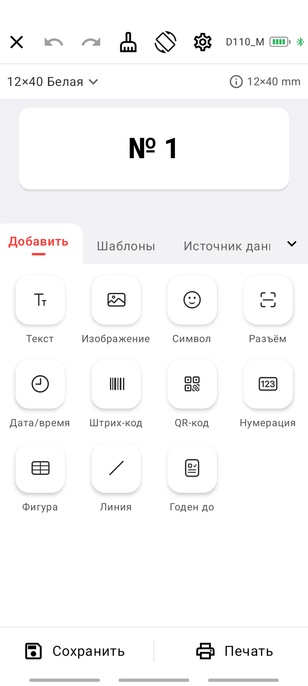
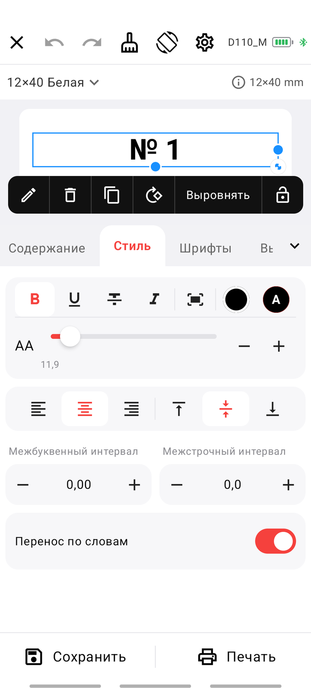
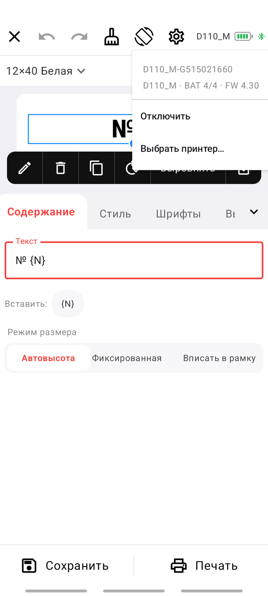
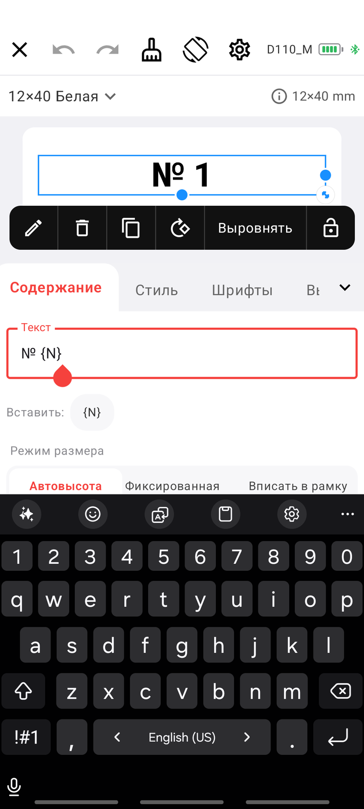

<p align="right">
  <a href="README.md"> English</a>
  &nbsp;·&nbsp;
   <b>Deutsch</b>
  &nbsp;·&nbsp;
  <a href="README.ru.md"> Русский</a>
</p>

> **Fork-Hinweis.** Dies ist ein experimenteller Fork von [TobseF/NiimStudio](https://github.com/TobseF/NiimStudio)
> mit russischer Oberfläche, überarbeitetem unterem Editor-Bereich und Drucker-Korrekturen. Teile der
> Änderungen wurden mit KI-Unterstützung erzeugt („нейрослоп“) und nicht so gründlich geprüft wie
> upstream — Verwendung auf eigene Gefahr. Proprietäre Microsoft-Schriften und aus der Hersteller-App
> nachgezeichnete Icons sind **nicht** enthalten; es werden Systemschriften und integrierte Material-Icons
> verwendet. Releases erscheinen, falls vorhanden, in diesem Fork und nicht upstream.

<p align="center">
  <picture>
    <source media="(prefers-color-scheme: dark)" srcset="docs/media/banner-dark.svg">
    
  </picture>
</p>

<p align="center">
  <a href="https://github.com/Valinok/NiimStudio/releases/latest"></a>
  
  <a href="LICENSE"></a>
  
</p>

<p align="center">
  <b>Der freie Etiketten-Designer für NIIMBOT-Drucker.</b><br>
  Kabelfahnen, Lager-Etiketten und Preisschilder am Handy gestalten und per Bluetooth drucken –<br>
  ohne Konto, ohne Cloud, ohne Werbung.
</p>

<p align="center">
  <a href="https://github.com/Valinok/NiimStudio/releases/latest"></a>
</p>

##  Funktionen

- **Was du siehst, wird gedruckt** – Drag & Drop, Pinch-Zoom, Hilfslinien zum Einrasten, Rückgängig/Wiederholen und eine 1-Bit-Druckvorschau, die exakt dem Etikett entspricht.
- **Alles, was ein Etikett braucht** – Text, Bilder, über 200 Symbole, Datum und MHD, Barcodes, QR-Codes, Seriennummern, Formen und Linien.
- **Präzises Layout** – am Etikett ausrichten, mit dem Steuerkreuz verschieben und jeden Wert direkt bearbeiten: mit Live-Vorschau, Runden und den zuletzt genutzten Werten.
- **Kabel-Etiketten** – 17 Steckersymbole (USB, HDMI, RJ45, DC …) und Kabelfahnen, die beidseitig bedruckt um das Kabel gelegt werden.
- **Profile & Vorlagen** – editierbare Etikettengrößen, Layouts als Vorlage mit Vorschaubild speichern.
- **Serien drucken** – Platzhalter aus einer Liste oder CSV füllen oder Etiketten automatisch nummerieren.
- **Privat** – läuft komplett offline, kein Konto, nicht einmal eine Internet-Berechtigung.
- **Druckerstatus auf einen Blick** – Modell, Akkustand (4 Balken) und Bluetooth-Status stehen in einem antippbaren Kopfbereich; ein Tap zeigt Firmware und Verbindungsdetails.
- **Deine Sprache** – Deutsch, Englisch und Russisch, weitere Sprachen lassen sich leicht ergänzen.

##  Screenshots

<table>
  <tr>
    <td align="center"><br><sub>Alle Elemente</sub></td>
    <td align="center"><br><sub>Symbolbibliothek</sub></td>
    <td align="center"><br><sub>QR-Codes</sub></td>
    <td align="center"><br><sub>Fanglinien</sub></td>
    <td align="center"><br><sub>Druckvorschau</sub></td>
  </tr>
</table>

##  Download & Installation

NiimStudio läuft ab **Android 8.0** und braucht Bluetooth. Wähle den Weg, der dir am besten passt:

| | So geht's | Updates |
|---|---|---|
| **GitHub Releases** | `NiimStudio-<version>-release.apk` aus dem [neuesten Release](https://github.com/Valinok/NiimStudio/releases/latest) laden und öffnen. | manuell |
| **Komi Store** | Im [Komi Store](https://github.com/komi-store/komi-store) (früher GitHub Store) nach **NiimStudio** suchen. | automatisch |
| **F-Droid** | Demnächst. | automatisch |

<details>
<summary><b>Mit Komi Store installieren</b></summary>

1. [Komi Store](https://github.com/komi-store/komi-store) (früher GitHub Store) installieren – über
   [F-Droid](https://f-droid.org/packages/zed.rainxch.githubstore/) oder die GitHub-Releases.
2. Nach **NiimStudio** suchen (oder das Repository `Valinok/NiimStudio` öffnen).
3. **Installieren** tippen. Komi Store hält die App aktuell.

</details>

<details>
<summary><b>F-Droid</b></summary>

<a href="#"></a>

NiimStudio ist für F-Droid vorbereitet (Store-Texte und Grafiken in `fastlane/`). Der Link erscheint hier,
sobald die App veröffentlicht ist.

</details>

##  Unterstützte Drucker

| Drucker | Status |
|---|---|
| **NIIMBOT B18** | ✅ im upstream getestet |
| **NIIMBOT D110_M** | ✅ in diesem Fork getestet (Variante Legacy/D110, 203 dpi, Dichte 1–5) |
| Andere NIIMBOT-Modelle | funktionieren wahrscheinlich, wenn sie dasselbe Protokoll sprechen – ungetestet, [Rückmeldung willkommen](https://github.com/Valinok/NiimStudio/issues) |

##  Erster Druck in einer Minute

1. Drucker einschalten, NiimStudio öffnen und den Bluetooth-Zugriff erlauben.
2. Auf den **Bluetooth**-Knopf tippen und den Drucker wählen (z. B. `B18-…`).
3. Oben die Etikettengröße wählen (z. B. **12×40**), Text, Symbole oder Stecker hinzufügen.
4. **Druck** tippen.

---

##  Entwicklung

Kotlin, Jetpack Compose und Material 3. Voraussetzungen: JDK 17 und das Android SDK.

```bash
./gradlew assembleDebug          # app/build/outputs/apk/debug/NiimStudio-<version>-debug.apk
./gradlew testDebugUnitTest      # Unit-Tests (Protokoll, Layout, Übersetzungen)
```

| Ordner | Inhalt |
|---|---|
| `model/`, `data/` | Etikettenmodell und Speicherung |
| `render/` | ein Renderer für Editor und Drucker (8 Punkte/mm) |
| `printer/`, `protocol/`, `transport/` | Verbindung, NIIMBOT-Protokoll, SPP/BLE – siehe [Protokoll-Notizen](docs/protocol.md) (englisch) |
| `ui/` | Jetpack-Compose-Oberfläche |

<details>
<summary> <b>Sprache hinzufügen</b></summary>

1. `app/src/main/res/values/strings.xml` nach `app/src/main/res/values-<code>/strings.xml` kopieren (z. B. `values-fr`).
2. Die Texte übersetzen. Platzhalter wie `%1$s`, `%1$d` und `{N}` bleiben erhalten. Bei Symbolnamen
   (`sym_…`) steht nach `|` eine Liste von Suchbegriffen.
3. `./gradlew testDebugUnitTest` ausführen.

Mehr ist nicht nötig: Der Build erkennt den neuen Ordner und nimmt die Sprache in die Auswahl auf.
`TranslationsTest` meldet fehlende Schlüssel, abweichende Platzhalter sowie fehlende Plural- oder Array-Einträge.

</details>

<details>
<summary> <b>Steckersymbole bearbeiten oder ergänzen</b></summary>

Die Steckersymbole sind einfache SVG-Dateien in `app/src/main/assets/connectors/` (`usba.svg`, `hdmi.svg` …).
Mit einem Vektorprogramm (z. B. Inkscape) bearbeiten und die App neu bauen.

- Höhe 100 Einheiten (`viewBox="0 0 <Breite> 100"`), Umrisse schwarz mit `stroke-width="9"`, Kontakte als
  schwarze Flächen. Das Seitenverhältnis kommt aus der viewBox.
- Neuer Stecker: eine weitere SVG ablegen. Der Dateiname ist der Schlüssel; der Name kommt aus dem String
  `conn_<dateiname>`, falls vorhanden (übersetzbar), sonst aus dem `<title>` der SVG.
- Bestehende Dateien nicht umbenennen – gespeicherte Etiketten verweisen über den Namen darauf.

</details>

<details>
<summary> <b>Release veröffentlichen</b></summary>

Releases baut, signiert und veröffentlicht GitHub Actions ([release.yml](.github/workflows/release.yml)).
Die Builds sind reproduzierbar, F-Droid liefert deshalb genau dieselbe APK mit der Signatur des Autors aus.

1. `versionCode` und `versionName` in `app/build.gradle.kts` erhöhen.
2. `fastlane/metadata/android/en-US/changelogs/<versionCode>.txt` (und `de-DE`) anlegen.
3. Committen, mit dem versionName taggen (z. B. `0.7`) und das Tag pushen. GitHub Actions legt das
   Release mit der signierten APK an; F-Droid übernimmt das Tag automatisch.

Einmalig einrichten: die Repository-Secrets `NIIMSTUDIO_KEYSTORE_BASE64`, `NIIMSTUDIO_STORE_PASSWORD`,
`NIIMSTUDIO_KEY_ALIAS` und `NIIMSTUDIO_KEY_PASSWORD`. Für lokale Release-Builds
`keystore.properties.example` nach `keystore.properties` kopieren.

</details>
<details>
<summary> <b>Store-Screenshots und README-Grafiken aktualisieren</b></summary>

Die Store-Screenshots werden auf einem Telefon aufgenommen und auf 720×1600 skaliert. Die README-Grafiken
(Banner, Icons, Flaggen) erzeugt `python tools/readme/make_assets.py`.

</details>

##  Danksagung

Öffentliche Repositories, die bei den Änderungen in diesem Fork verwendet wurden:

- [TobseF/NiimStudio](https://github.com/TobseF/NiimStudio) — Upstream-Projekt, auf dem dieser Fork basiert.
- [KunalBhargava182/OpenNiimbot-NiimBridge](https://github.com/KunalBhargava182/OpenNiimbot-NiimBridge) — MIT-Treiber und D110M_V4-Drucksequenz als Protokollreferenz für die Drucker-Korrekturen.
- [MultiMote/niimbluelib](https://github.com/MultiMote/niimbluelib) — Druckerprotokoll (MIT).
- [ZXing](https://github.com/zxing/zxing) — Barcodes und QR-Codes.
- [BigBadaboom/androidsvg](https://github.com/BigBadaboom/androidsvg) — SVG-Darstellung.
- [google/material-design-icons](https://github.com/google/material-design-icons) — Material-Symbole und -Icons (Apache 2.0).

Alle Lizenzen stehen in [THIRD_PARTY_NOTICES.md](THIRD_PARTY_NOTICES.md).

##  Lizenz

NiimStudio ist freie Software unter der [GNU General Public License v3.0](LICENSE).

<sub>NiimStudio ist ein unabhängiges Projekt und steht in keiner Verbindung zu NIIMBOT, wird von NIIMBOT weder
unterstützt noch gesponsert. NIIMBOT ist eine Marke des jeweiligen Inhabers und wird hier nur zur Beschreibung
der Kompatibilität genannt.</sub>
