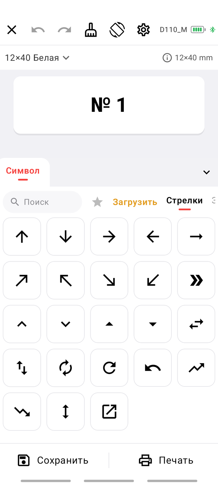

  <a href="README.md"> English</a>
  &nbsp;·&nbsp;
   <b>Deutsch</b>
  &nbsp;·&nbsp;
  <a href="README.ru.md"> Русский</a>

> **Korrektur: Das ist kompletter KI-Slop („нейрослоп“), kein sorgfältig geprüfter Fork.**

> **Fork-Hinweis.** Dies ist ein experimenteller Fork von [TobseF/NiimStudio](https://github.com/TobseF/NiimStudio)
> mit russischer Oberfläche, überarbeiteter unterer Editorleiste und Drucker-Korrekturen. Teile der Änderungen
> wurden mit KI-Unterstützung erstellt („нейрослоп“) und nicht so gründlich geprüft wie das Original —
> Verwendung auf eigenes Risiko. Proprietäre Microsoft-Schriften und vom Original abgemalte Icons sind
> hier **nicht** enthalten: es werden Systemschriften und eingebaute Material-Icons verwendet.
> Releases erscheinen in diesem Fork, nicht im upstream.

  
  
  
  
  

## Was sich in diesem Fork geändert hat

- **Russische Oberfläche** (Englisch und Deutsch bleiben verfügbar); diese README gibt es in allen drei Sprachen.
- **Stabile untere Leiste** — Tabs und Eingabefeld springen bei geöffneter Tastatur nicht mehr; das Etikett bleibt oben auf dem Canvas.
- **Druckerstatus auf einen Blick** — Modell, Akkustand (4 Balken) und Bluetooth-Status in einem antippbaren Kopfbereich; ein Tap zeigt Firmware und Verbindungsdetails.
- **NIIMBOT D110_M** funktioniert mit der Legacy/D110-Variante (203 dpi, Dichte 1–5).
- **Keine proprietären Assets** — keine Microsoft-TTF-Schriften und keine nachgezeichneten SVG-Icons; Systemschriften und Apache-2.0-Material-Icons als Fallback.
- **Editor-/Drucker-Korrekturen** — gedrosselte Entwürfe und Vorschau, Rückgängig/Wiederholen, Abbrechen des Drucks, Aufräumen nach dem Druck, Bluetooth-Heartbeat und Trennung.
- Komplett offline: kein Konto, keine Cloud und nicht einmal eine Internet-Berechtigung.

## Screenshots

| | | | | |
|---|---|---|---|---|
|  Alle Elemente |  Symbolbibliothek |  Stil-Leiste |  Druckerstatus / Akku |  Tastatur geöffnet |

## Download & Installation

NiimStudio braucht **Android 8.0+** und Bluetooth.

- **GitHub Releases:** `NiimStudio-<Version>-release.apk` aus dem [neuesten Release](https://github.com/Valinok/NiimStudio/releases/latest) laden und öffnen.
- **Droid-ify (oder ein anderer F-Droid-Client):** [Repository mit einem Tap hinzufügen](fdroidrepos://valinok.github.io/NiimStudio/fdroid/repo/?fingerprint=F04731C891EBFB25CD323255D0E873C950CCFF3386A46C069B8D02D38C12F733). Dort gibt es dieselbe signierte APK mit automatischen Updates. Manuell: URL `https://valinok.github.io/NiimStudio/fdroid/repo/`, Fingerprint `F04731C8 91EBFB25 CD323255 D0E873C9 50CCFF33 86A46C06 9B8D02D3 8C12F733`.

Dieser Fork nutzt einen eigenen Signaturschlüssel. Eine bereits installierte Version aus dem upstream oder einer anderen Quelle muss vorher deinstalliert werden.

## Unterstützte Drucker

| Drucker | Status |
|---|---|
| **NIIMBOT B18** | ✅ im upstream getestet |
| **NIIMBOT D110_M** | ✅ in diesem Fork getestet (Variante Legacy/D110, 203 dpi, Dichte 1–5) |

## Danksagung

Öffentliche Repositories, die bei den Änderungen in diesem Fork verwendet wurden:

- [TobseF/NiimStudio](https://github.com/TobseF/NiimStudio) — Upstream-Projekt, auf dem dieser Fork basiert.
- [KunalBhargava182/OpenNiimbot-NiimBridge](https://github.com/KunalBhargava182/OpenNiimbot-NiimBridge) — MIT-Treiber und D110M_V4-Drucksequenz als Protokollreferenz für die Drucker-Korrekturen.
- [MultiMote/niimbluelib](https://github.com/MultiMote/niimbluelib) — Druckerprotokoll (MIT).
- [ZXing](https://github.com/zxing/zxing) — Barcodes und QR-Codes.
- [BigBadaboom/androidsvg](https://github.com/BigBadaboom/androidsvg) — SVG-Darstellung.
- [google/material-design-icons](https://github.com/google/material-design-icons) — Material-Symbole und -Icons (Apache 2.0).

Alle Lizenzen stehen in [THIRD_PARTY_NOTICES.md](THIRD_PARTY_NOTICES.md).

## Lizenz

GPL-3.0 — siehe [LICENSE](LICENSE). NiimStudio ist ein unabhängiges Projekt und steht in keiner Verbindung zu NIIMBOT.
