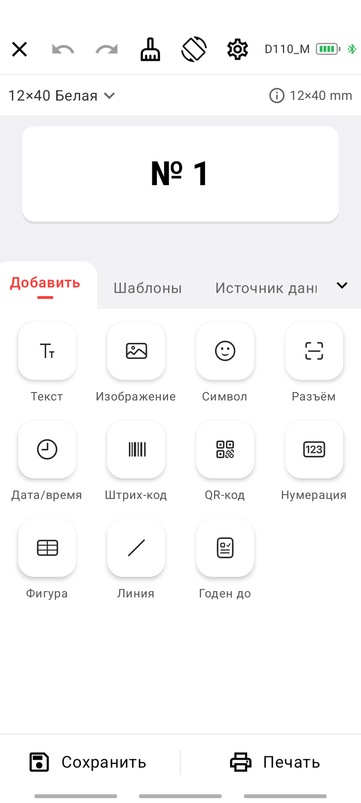
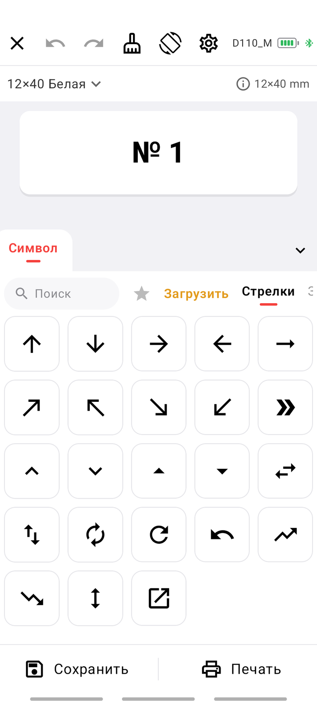
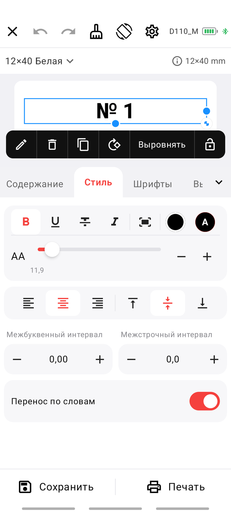
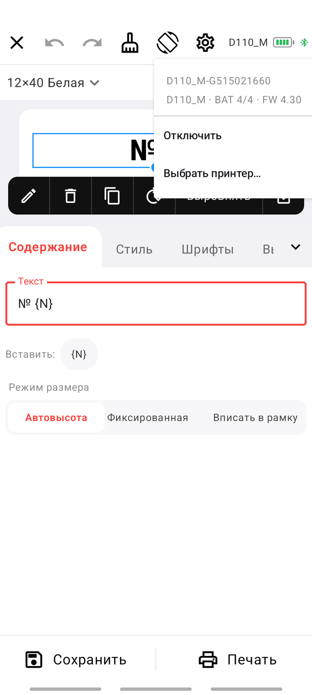
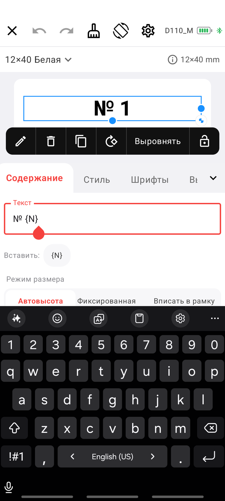

   <b>English</b>
  &nbsp;·&nbsp;
  <a href="README.de.md"> Deutsch</a>
  &nbsp;·&nbsp;
  <a href="README.ru.md"> Русский</a>

> **Fork notice.** This is an experimental fork of [TobseF/NiimStudio](https://github.com/TobseF/NiimStudio)
> with a Russian UI, a reworked bottom editor panel and printer fixes. Parts of the changes were
> generated with AI assistance ("нейрослоп") and have not received the same review as upstream — use
> them at your own risk. Proprietary Microsoft fonts and icons traced from the vendor app are **not**
> distributed here: system fonts and built-in Material icons are used instead. Releases are published
> from this fork, not from upstream.

  
  
  
  
  

## What changed in this fork

- **Russian UI** (English and German remain available); this README is also translated into all three languages.
- **Stable bottom panel** — tabs and the content field no longer jump when the keyboard opens; the label stays at the top of the canvas.
- **Printer status at a glance** — model, battery level (4 bars) and Bluetooth state in one tappable header block; tapping it shows firmware and connection details.
- **NIIMBOT D110_M** works with the Legacy/D110 variant (203 dpi, density 1–5).
- **No proprietary assets** — Microsoft TTF fonts and traced SVG icons are absent; system fonts and Apache-2.0 Material icon fallbacks are used.
- **Editor/printer fixes** — debounced drafts and preview, undo/redo, cancel-print, print-end cleanup, Bluetooth heartbeat and disconnect handling.
- Fully offline: no account, no cloud, and not even the internet permission.

## Screenshots

| | | | | |
|---|---|---|---|---|
|  All elements |  Symbol library |  Style panel |  Printer status / battery |  Keyboard open |

## Install

NiimStudio needs **Android 8.0+** and Bluetooth.

- **GitHub Releases:** download `NiimStudio-<version>-release.apk` from the [latest release](https://github.com/Valinok/NiimStudio/releases/latest) and open it.
- **Droid-ify (or another F-Droid client):** [add our repository with one tap](fdroidrepos://valinok.github.io/NiimStudio/fdroid/repo/?fingerprint=F04731C891EBFB25CD323255D0E873C950CCFF3386A46C069B8D02D38C12F733). It provides the same signed APK with automatic updates. Manual details: URL `https://valinok.github.io/NiimStudio/fdroid/repo/`, fingerprint `F04731C8 91EBFB25 CD323255 D0E873C9 50CCFF33 86A46C06 9B8D02D3 8C12F733`.

This fork uses its own signing key. If a version from upstream or another source is already installed, uninstall it first.

## Supported printers

| Printer | Status |
|---|---|
| **NIIMBOT B18** | ✅ tested in upstream |
| **NIIMBOT D110_M** | ✅ tested in this fork (Legacy/D110 variant, 203 dpi, density 1–5) |

## Credits

Public repositories used for the changes in this fork:

- [TobseF/NiimStudio](https://github.com/TobseF/NiimStudio) — upstream project this fork is based on.
- [KunalBhargava182/OpenNiimbot-NiimBridge](https://github.com/KunalBhargava182/OpenNiimbot-NiimBridge) — MIT driver and D110M_V4 print sequence used as the protocol reference for the printer fixes.
- [MultiMote/niimbluelib](https://github.com/MultiMote/niimbluelib) — printer protocol (MIT).
- [ZXing](https://github.com/zxing/zxing) — barcodes and QR codes.
- [BigBadaboom/androidsvg](https://github.com/BigBadaboom/androidsvg) — SVG rendering.
- [google/material-design-icons](https://github.com/google/material-design-icons) — Material symbols and icons (Apache 2.0).

All licenses are listed in [THIRD_PARTY_NOTICES.md](THIRD_PARTY_NOTICES.md).

## License

GPL-3.0 — see [LICENSE](LICENSE). NiimStudio is an independent project and is not affiliated with NIIMBOT.
