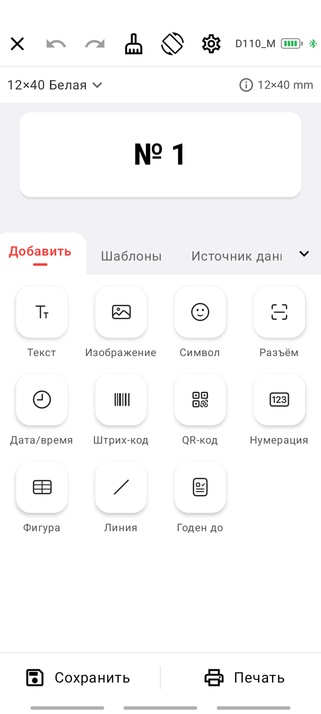
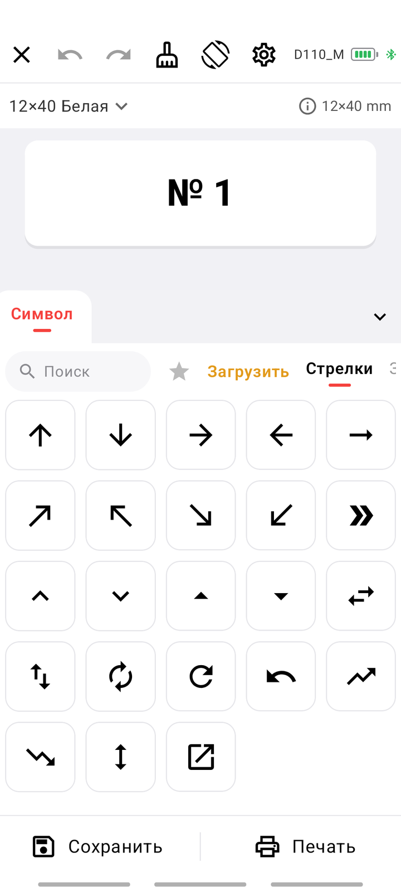
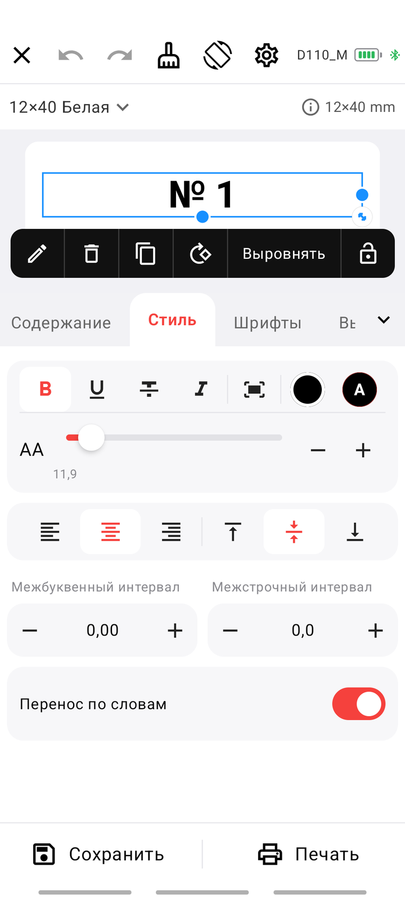
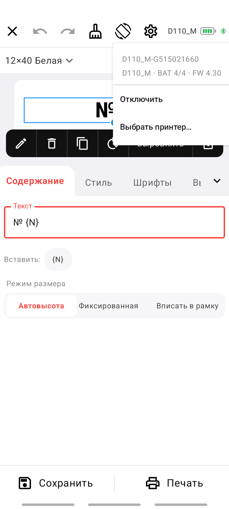
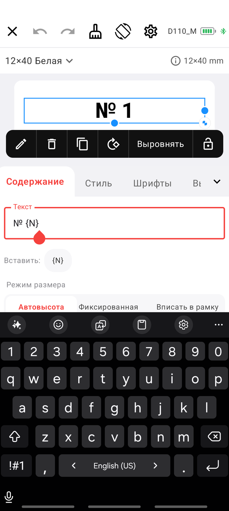

  <a href="README.md"> English</a>
  &nbsp;·&nbsp;
  <a href="README.de.md"> Deutsch</a>
  &nbsp;·&nbsp;
   <b>Русский</b>

> **О форке.** Это экспериментальный форк [TobseF/NiimStudio](https://github.com/TobseF/NiimStudio):
> русский интерфейс, переработанная нижняя панель редактора и исправления в драйвере принтера.
> Часть изменений сделана с помощью ИИ («нейрослоп») и прошла не такое тщательное ревью, как
> оригинал — используйте на свой страх и риск. Проприетарные шрифты Microsoft и иконки,
> обведённые с родного приложения, **не входят** в репозиторий: используются системные шрифты
> и встроенные иконки Material. Релизы публикуются в этом форке, а не в upstream.

  
  
  
  
  

## Что изменилось в этом форке

- **Русский интерфейс** (английский и немецкий остались); это описание переведено на все три языка.
- **Неподвижная нижняя панель** — вкладки и поле ввода не прыгают при клавиатуре, этикетка остаётся сверху холста.
- **Состояние принтера на виду** — модель, заряд (4 полоски) и Bluetooth в одном нажимаемом блоке сверху; по нажатию видны прошивка и детали подключения.
- **NIIMBOT D110_M** работает с вариантом Legacy/D110 (203 dpi, плотность 1–5).
- **Без проприетарных ассетов** — шрифтов Microsoft и обведённых SVG-иконок нет; системные шрифты и иконки Material (Apache-2.0) как fallback.
- **Исправления редактора и печати** — задержка черновика и предпросмотра, undo/redo, отмена печати, очистка после печати, heartbeat и корректное отключение Bluetooth.
- Полностью офлайн: без аккаунта, без облака и даже без разрешения на интернет.

## Скриншоты

| | | | | |
|---|---|---|---|---|
|  Все элементы |  Библиотека символов |  Панель стиля |  Принтер и заряд |  Открытая клавиатура |

## Скачивание и установка

NiimStudio требует **Android 8.0+** и Bluetooth.

- **GitHub Releases:** скачайте `NiimStudio-<версия>-release.apk` из [последнего релиза](https://github.com/Valinok/NiimStudio/releases/latest) и откройте его.
- **Droid-ify (или другой F-Droid-клиент):** [добавьте наш репозиторий в одно касание](fdroidrepos://valinok.github.io/NiimStudio/fdroid/repo/?fingerprint=F04731C891EBFB25CD323255D0E873C950CCFF3386A46C069B8D02D38C12F733). Там же подписанный APK с автоматическими обновлениями. Вручную: URL `https://valinok.github.io/NiimStudio/fdroid/repo/`, отпечаток `F04731C8 91EBFB25 CD323255 D0E873C9 50CCFF33 86A46C06 9B8D02D3 8C12F733`.

Форк подписан своим ключом. Если уже стоит версия из upstream или другого источника, её нужно сначала удалить.

## Поддерживаемые принтеры

| Принтер | Статус |
|---|---|
| **NIIMBOT B18** | ✅ проверен в upstream |
| **NIIMBOT D110_M** | ✅ проверен в этом форке (вариант Legacy/D110, 203 dpi, плотность 1–5) |

## Благодарности

Публичные репозитории, которые использовались при правках в этом форке:

- [TobseF/NiimStudio](https://github.com/TobseF/NiimStudio) — upstream-проект, на котором основан форк.
- [KunalBhargava182/OpenNiimbot-NiimBridge](https://github.com/KunalBhargava182/OpenNiimbot-NiimBridge) — MIT-драйвер и последовательность печати D110M_V4: основной эталон протокола при правках D110_M.
- [MultiMote/niimbluelib](https://github.com/MultiMote/niimbluelib) — протокол принтера (MIT).
- [ZXing](https://github.com/zxing/zxing) — штрихкоды и QR-коды.
- [BigBadaboom/androidsvg](https://github.com/BigBadaboom/androidsvg) — рендеринг SVG.
- [google/material-design-icons](https://github.com/google/material-design-icons) — символы и иконки Material (Apache 2.0).

Все лицензии перечислены в [THIRD_PARTY_NOTICES.md](THIRD_PARTY_NOTICES.md).

## Лицензия

GPL-3.0 — см. [LICENSE](LICENSE). NiimStudio — независимый проект, не связанный с NIIMBOT.
